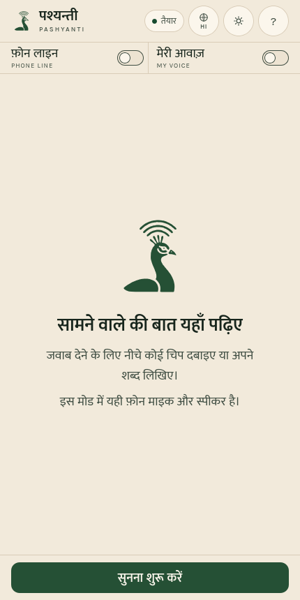
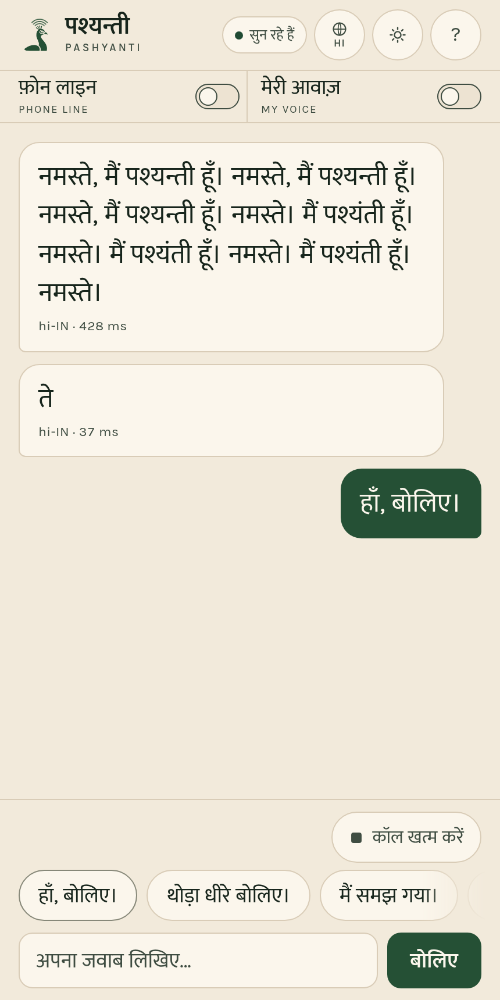

# Talk mode — the phone is the microphone and the speaker

Status: built 2026-11-14 on `feat/talk-mode`. It is **not in the 60-second
video**: the demo path is still the server microphone (the caller in the room,
the laptop hearing them, the reply from the laptop speaker), and that path is
unchanged. This is the feature for when the laptop is not there.

| Start | After the tap |
|---|---|
|  |  |

## Why

The owner's requirement: *the laptop will not be there.* The user holds the
phone, another person speaks to them in the same room, the speech appears as
text on the phone, the user taps a reply, and the phone speaks it to the other
person. That is an **in-person conversation**, not a phone call, and it cannot
be built on server-side capture — the server is not necessarily in the room.

`?mode=talk` therefore reverses D-004 for this mode only
([`DECISIONS.md`](DECISIONS.md) amendment). The server keeps the API key and the
Prisma/Timbre calls; it opens no audio device.

## Run it

```fish
# 1. the built app + server (no --phone-line for a first check)
cd divya/web && ../../scripts/with-cache.sh bun run build
cd ../backend && ../../scripts/with-cache.sh uv run python server.py

# 2. a secure context — getUserMedia needs one; http://<lan-ip> does not count
ngrok http 8080                     # → https://<random>.ngrok-free.dev

# 3. on the phone, in the browser
#    https://<random>.ngrok-free.dev/?mode=talk&lang=hi
#    tap सुनना शुरू करें / Start listening, allow the microphone
```

`ngrok` is the chosen path because it needs no certificate on the phone. The
offline alternative is a certificate the phone already trusts:

```fish
uv run python server.py --tls cert.pem key.pem   # then https://<lan-ip>:8080/?mode=talk
```

A desktop can be checked on `http://localhost:8080/?mode=talk` — `localhost` is
a secure context — but a phone on the LAN is not.

### On the phone

1. Open the tunnel URL with `?mode=talk`. The empty state says the phone is the
   microphone and the speaker, and the footer has one button.
2. Tap **Start listening**. The browser asks for the microphone; allow it.
   The button says "Starting…" for about two seconds while Prisma's socket
   completes its handshake (frames sent meanwhile are queued, not dropped).
3. Hold the phone facing the other person. Their speech appears as text.
4. Tap a chip or type; the phone plays the reply. **Capture pauses while the
   reply plays** — that is half-duplex, not a bug (D-005).
5. `कॉल खत्म करें` ends the session and shows the same summary card.

The two demo toggles still work in this mode: *फ़ोन लाइन* re-paces the page's
16 kHz frames through the same 8 kHz µ-law transform, and *मेरी आवाज़* uses the
cloned voice (still Hindi only, D-012).

## What happens on the wire

- **Capture.** `getUserMedia({echoCancellation, noiseSuppression, autoGainControl,
  channelCount:1})` feeds an **AudioWorklet** (`web/src/talk.ts`), which linearly
  resamples the device rate to **16 kHz**, builds **Int16 samples**, and posts a
  frame every **512 samples = 1024 bytes = 32 ms**. The page sends it as a
  binary WebSocket message. No `MediaRecorder`, no WebM/Opus.
- **Relay.** `server.Call` hands each binary frame to `stt.BrowserMic`, whose
  `FrameParser` yields only whole 1024-byte frames (a split send is joined, a
  partial one is not padded), and whose pump sends **one frame per 32 ms** to
  `wss://api.vachana.ai/stt/v3/stream` with the normal laptop VAD preset
  (`0.55 / 350 / 100 / 120`). Silence fills a gap; the queue is bounded at 128
  frames (4 s), so a network burst never becomes a burst at Prisma.
- **Reply.** `Call.on_reply` streams Timbre's PCM as `audio` messages
  (`{data: base64, rate: 16000}`), ending with an empty `final: true`. The page
  schedules the chunks through Web Audio on the same `AudioContext` that
  captures; a cache hit replays the whole clip in ~0 ms.
- **Half-duplex, both halves.** The server sends silence while it streams; the
  page drops outgoing frames from `status: speaking` until its player drains.
- **The handshake.** The page sends `start_capture` on the tap; the server opens
  Prisma and answers `capture: ready`, and only then does the footer show the
  chips/composer.

The protocol table lives in [`ARCHITECTURE.md`](ARCHITECTURE.md); `audio`,
`capture` and `start_capture` are the three new rows.

## Evidence (14 November 2026)

Two runs, both reproducible from the repository plus a scratch script.

**A. A wav replayed as the phone** ([`../backend/talk_replay.py`](../backend/talk_replay.py),
a websocket client that speaks `?mode=talk`, sends `smoke.wav` as 1024-byte
frames at 32 ms, then taps a reply):

| Measured | Value |
|---|---|
| Frames sent | 65 × 1024 bytes = 66,560 bytes (2.08 s), exactly 32 ms apart |
| Transcript | `नमस्ते, मैं पश्यन्ती हूँ।`, `hi-IN`, API latency 100 ms |
| Reply audio back | 27 chunks, 58,880 bytes = 1.84 s of 16 kHz PCM |
| Tap → first audio, uncached | 1409 ms |
| Same reply, cached | 0 ms, 2 chunks, identical 58,880 bytes |

**B. A real browser over HTTPS** (Chrome via Puppeteer with a fake microphone
device playing the same wav, page loaded through `ngrok`, exactly what a phone
does; a throwaway harness, not committed — Puppeteer is not a project
dependency):

| Measured | Value |
|---|---|
| Binary frames sent by the page | 585, **every one 1024 bytes** |
| Cadence | min 29 ms, median **32 ms**, max 2592 ms — the max is the reply, when capture is muted |
| Transcript | `hi-IN`, API latency 428 ms, bubble on screen |
| Tap a chip → reply | 17 audio chunks, 43,520 bytes = 1.36 s of PCM, `speak` + reply bubble |
| `speak.ttfa_ms` | 2430 ms (uncached, over the tunnel) |
| Status sequence | `speaking → listening`; console clean |

The 2592 ms gap is the page half of half-duplex working: capture was stopped
while the reply played, so the phone did not hear itself.

## Reproduce A

```fish
cd divya/backend
uv run python server.py                        # terminal 1
uv run python talk_replay.py smoke.wav         # terminal 2, ~25 s
```

It prints the transcript, the reply's `ttfa`/`cached`/`lang` and the audio that
came back. Run it twice: the second reply is cached and reports 0 ms. The
browser run in B needs Chrome, Puppeteer and a tunnel, so it lives outside the
repository; the replay tool and the unit suite are what can be checked here.

## What was not verified

State this plainly; none of these were tested.

- **A physical phone.** The browser run used Chrome with a fake capture device
  over the real HTTPS tunnel; no handset, no Android Chrome, no iOS Safari. The
  iOS `AudioContext`-needs-a-gesture path is implemented (the start button is the
  gesture) but not exercised.
- **Real room acoustics.** The "caller" was a wav, so the audio path is real but
  the acoustic path — speaker, room, echo canceller, AGC — is not. Half-duplex is
  measured; echo cancellation quality is not.
- **A real person speaking twice, overlapping, or interrupting.** No barge-in by
  design.
- **The cloned voice in a non-Hindi language** — TTS is Hindi until #2 lands.
- **Tunnels.** `ngrok` free URLs change on restart, which changes the page origin
  and therefore the stored microphone permission; a fixed domain was not tried.
- **Long sessions.** Prisma caps a streaming socket at 15 minutes and
  `BrowserMic` does not reconnect when it closes; a long conversation loses the
  session. The demo path has the same cap.

## Troubleshooting

| Symptom | Cause | Fix |
|---|---|---|
| Tapping "Start listening" changes nothing, note says HTTPS | `window.isSecureContext` is false | open over `https://` (tunnel or `--tls`) or `localhost` |
| Note says the browser cannot capture | no `getUserMedia`/`AudioWorklet` | use Chrome, Edge, Safari 14.1+, or Firefox on Android |
| Note says the microphone was blocked | permission denied for this origin | allow it in site settings, reload; a new tunnel URL asks again |
| "Starting…" then the error pill | the Prisma socket failed to open | check the key and network; the page retries on reload |
| No transcript, frames flowing | the server logs frames at close (`talk mode: N frames in, M to Prisma`) | if M is 0, `start_capture` never completed |
| Reply is silent but the bubble appears | `AudioContext` suspended (iOS backgrounding) | tap again on the page; the player resumes on a gesture |
